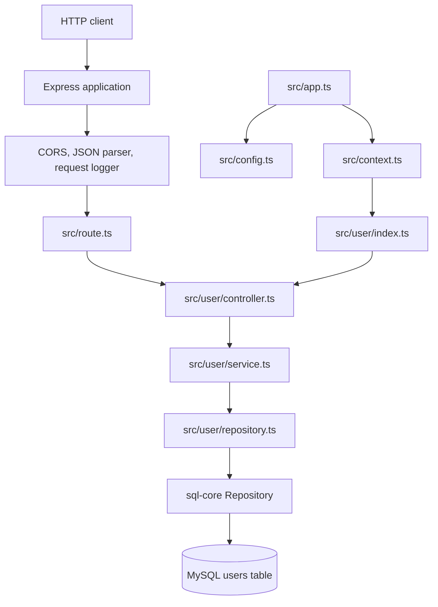

# sql-modular-sample

A small TypeScript backend sample built with Express 5 and MySQL. The application exposes a `users` HTTP API and demonstrates a modular structure in which an HTTP controller delegates to a use case, which delegates persistence to a SQL repository.

This README is intended for people onboarding to the project. For AI-assisted development, read [`AGENTS.md`](./AGENTS.md) first.

## What is included

- Express application bootstrap and middleware setup.
- MySQL connection pool and `sql-core` repository integration.
- A `users` module with search, load, create, update, patch, and delete operations.
- Shared application context for health, log configuration, middleware configuration, and user controllers.
- English and Vietnamese validation/resource messages.
- TypeScript compilation through `ts-loader` and Webpack.

The repository currently contains one business module: `src/user`. There are no checked-in database migrations, test cases, or separate API specification files in the supplied project archive.

## Architecture at a glance



The business module follows this source-level dependency direction:

1. `user.ts` defines the user contracts and validation metadata.
2. `repository.ts` connects the contracts to the `users` SQL table.
3. `service.ts` provides the use-case layer using the shared `UseCase` base class.
4. `controller.ts` translates HTTP requests into service calls and HTTP responses.
5. `index.ts` constructs and exports the module controller.

See [`docs/architecture.md`](./docs/architecture.md) for details and the expected pattern when adding a module.

## Project layout

```text
src/
  app.ts                 Application bootstrap and HTTP server
  config.ts              Default and environment-specific configuration
  context.ts             Shared dependencies and controller construction
  route.ts               Express route registration
  resources/
    en.ts                English validation/resource strings
    vi.ts                Vietnamese validation/resource strings
    index.ts             Resource lookup by language
  user/
    user.ts              User, filter, repository/service contracts, model metadata
    repository.ts        SQL repository for the users table
    service.ts           User use case
    controller.ts        HTTP handlers
    index.ts             User module factory and exports
```

Other root files:

- `package.json` and `package-lock.json`: scripts and dependencies.
- `tsconfig.json`: strict TypeScript compiler settings.
- `.prettierrc.json`: formatting preferences.
- `webpack.config.js`: Node-targeted Webpack build.
- `.env`: local environment file in the supplied archive. Do not commit real credentials or copy its values into documentation.

## Database

The supplied database design for this sample is:

```sql
create table if not exists users (
  id varchar(40) primary key,
  username varchar(120),
  email varchar(120),
  phone varchar(45),
  date_of_birth datetime
);
```

The `id` column is the primary key. The other columns have no `NOT NULL` constraint in this DDL and are therefore nullable at the database-schema level.

The current validation metadata in `src/user/user.ts` does not perfectly match this DDL: it sets `username` length to 255 (the DDL says 120), `phone` length to 14 (the DDL says 45), and marks `username`, `email`, and `phone` as required even though the DDL does not declare those columns `NOT NULL`. In addition, the TypeScript `User` interface marks `email` and `phone` optional, while the model metadata marks both required. These are existing inconsistencies, not assumptions to silently resolve. Read [`docs/data-model.md`](./docs/data-model.md) before changing the user model or generating related features.

## HTTP API

The routes are registered in `src/route.ts`.

| Method | Path | Purpose |
|---|---|---|
| `GET` | `/health` | Health check |
| `PATCH` | `/log` | Configure logging through the shared log controller |
| `PATCH` | `/middleware` | Configure request middleware through the shared middleware controller |
| `GET` | `/users/search` | Search users |
| `POST` | `/users/search` | Search users |
| `GET` | `/users/:id` | Load one user by ID |
| `POST` | `/users` | Create a user |
| `PUT` | `/users/:id` | Update a user; the path ID is assigned to the request model |
| `PATCH` | `/users/:id` | Partially update a user; the path ID is assigned to the request model |
| `DELETE` | `/users/:id` | Delete a user by ID |

The current handlers return these status codes on their normal paths:

- Search: `200`.
- Load: `200` when found, otherwise `404`.
- Create: `201` when `isSuccessful(result)` is true, otherwise `409`.
- Update and patch: `200` when successful, otherwise `404`.
- Delete: `200` when the affected count is greater than zero, otherwise `410`.
- Validation failures use `getStatusCode(errors)`; caught errors are passed to `handleError`.

The exact search query syntax and response object shape are delegated to `express-web-kit`, `onecore`, and `sql-core`; they are not fully specified by this repository's source files. Do not invent a query contract without checking those library APIs or an existing caller.

See [`docs/http-api.md`](./docs/http-api.md).

## Install and run

Use a Node.js version compatible with the dependency versions in `package-lock.json` and the project's TypeScript toolchain. No specific Node.js engine version is declared in `package.json`.

```bash
npm install
npm run dev
```

The `dev` and `start` scripts both launch `src/app` through `nodemon` and `ts-node-dev`.

For a production bundle:

```bash
npm run build
npm run prod
```

Webpack writes `dist/app.js`; the `prod` script starts `dist/app` (Node resolves the `.js` file). The Webpack configuration also enables `BundleAnalyzerPlugin`.

Before running the app, configure a reachable MySQL database using the settings in `src/config.ts` and the local environment mechanism. The archive's `.env` contains the variable names `DB_DATABASE`, `DB_PASSWORD`, and `ENV`; its values are deliberately not reproduced here. The config merge uses `config-plus` and should be checked against that package's documented behavior before adding environment-variable conventions.

The environment presets defined in `src/config.ts` are:

- `sit`: changes the database name to `masterdata_sit`.
- `prd`: changes the log level to `error` and disables middleware logging.

The config file currently contains a literal fallback database password. Replace secret defaults with environment-managed secrets before deploying; never copy credentials from `.env` into source control or documentation.

## Useful commands

| Command | Current behavior |
|---|---|
| `npm run dev` | Starts the development server with reload tooling |
| `npm start` | Same command as `dev` |
| `npm run build` | Builds `dist/app.js` with Webpack |
| `npm run prod` | Runs the production bundle |
| `npm test` | Placeholder script that exits with an error; no test suite is configured |
| `npm run lint` | Runs ESLint using `.eslintrc.js`; that config file and ESLint dependency are not present in the supplied archive, so the script needs setup before it can be relied on |

## Further documentation

- [`AGENTS.md`](./AGENTS.md) — instructions for AI coding agents.
- [`docs/architecture.md`](./docs/architecture.md) — module responsibilities, dependency direction, and feature implementation workflow.
- [`docs/coding-conventions.md`](./docs/coding-conventions.md) — observed TypeScript style and conventions to follow.
- [`docs/data-model.md`](./docs/data-model.md) — SQL schema, TypeScript model, validation metadata, and known mismatches.
- [`docs/http-api.md`](./docs/http-api.md) — routes and current controller response behavior.
- [`docs/runtime-configuration.md`](./docs/runtime-configuration.md) — startup, dependency wiring, environment configuration, logging, and health checks.

# sql-modular-sample

A simple modular RESTful microservice built with [**Express**](https://www.npmjs.com/package/express), [**MySQL**](https://www.npmjs.com/package/mysql2), and the [**core-ts**](https://github.com/core-ts) ecosystem.

This project demonstrates how to build a clean, lightweight, and maintainable SQL-based microservice without using heavy frameworks, decorators, or dependency injection containers. It showcases explicit dependency composition, generic repositories, reusable CRUD use cases, request validation, and structured logging.

Unlike the more opinionated samples, this project keeps the request-processing flow explicit, making it an excellent starting point for learning how the Core TS libraries work together.

---

# Features

- Modular project structure
- RESTful CRUD APIs
- Configuration management
- Structured logging
- Health check endpoint
- Localization support
- Request validation
- Generic CRUD services
- Generic SQL repositories
- MySQL support
- Express 5 compatible

---

# How to build and run

### `npm start`

Runs the app in the development mode.

### `npm run build`

Builds the app for production to the `dist` folder.

### `npm run prod`

Runs the app for production in the `dist` folder.

---

# Architecture


Business logic is independent of the MySQL driver. Repositories depend on the generic `DB` abstraction provided by [**sql-core**](https://www.npmjs.com/package/sql-core).

```text
   HTTP Request
         │
         ▼
 Express Controller
         │
         ▼
   Service Layer
         │
         ▼
  Repository Layer
         │
         ▼
     sql-core
         │
         ▼
    mysql2-core
         │
         ▼
       MySQL
```

---

# Technology Stack

- TypeScript
- Node.js
- Express 5
- MySQL

Core TS libraries:

- [config-plus](https://www.npmjs.com/package/config-plus)
- [logger-core](https://www.npmjs.com/package/logger-core)
- [middleware-logging](https://www.npmjs.com/package/middleware-logging)
- [express-web-kit](https://www.npmjs.com/package/express-web-kit)
- [types-validation](https://www.npmjs.com/package/types-validation)
- [validation-core](https://www.npmjs.com/package/validation-core)
- [mysql2-core](https://www.npmjs.com/package/mysql2-core)
- [sql-core](https://www.npmjs.com/package/sql-core)
- [onecore](https://www.npmjs.com/package/onecore)

---

# Project Structure

```text
src
│
├── app.ts                 # Application bootstrap
├── config.ts              # Application configuration
├── context.ts             # Dependency composition
├── route.ts               # Route registration
│
├── resources/             # Localization resources
│
└── user/
    ├── user.ts
    ├── repository.ts
    ├── service.ts
    ├── controller.ts
    └── index.ts
```

Each business feature is organized into its own module, making the project easy to extend and maintain.

---

# Layered Architecture

## Controller

Controllers are responsible for:

- Receiving HTTP requests
- Parsing request parameters
- Validating input
- Calling business services
- Returning HTTP responses

Business logic remains inside the use case layer.

---

## Service

The service layer contains application business logic.

Most CRUD functionality is inherited from reusable generic implementations provided by **onecore**, allowing services to stay small and focused.

```ts
export class UserUseCase
    extends UseCase<User, string, UserFilter> implements UserService
```

---

## Repository

The repository implementation is remarkably concise:

```ts
export class SqlUserRepository
    extends Repository<User, string, UserFilter>
```

Each repository extends reusable SQL repository implementations provided by [**sql-core**](https://www.npmjs.com/package/sql-core), requiring only:

- Database connection
- Table name
- Entity model

Everything else is inherited from [**sql-core**](https://www.npmjs.com/package/sql-core).

Custom queries can easily be added when needed.

This greatly reduces boilerplate while keeping the repository extensible for custom queries.

---

## Model

Models define:

- Entity structure
- Validation rules
- Metadata

Validation rules are centralized using [**validation-core**](https://www.npmjs.com/package/validation-core), keeping controllers concise and consistent.

---

# Dependency Composition

Dependencies are wired explicitly rather than using a dependency injection framework.

```text
  MySQL
    │
    ▼
Repository
    │
    ▼
 Service
    │
    ▼
Controller
```

All dependencies are created in `context.ts`, serving as the application's composition root.

---

# SQL Abstraction

One of the best aspects is the use of [`sql-core`](https://www.npmjs.com/package/sql-core).

Instead of repositories depending directly on MySQL APIs, they depend on the generic `DB` interface:

```ts
constructor(db: DB)
```

This means repositories are written against an abstraction rather than a specific database driver.

Benefits include:

- Database independence
- Reusable repositories
- Reduced infrastructure coupling
- Cleaner architecture
- Improved testability

---

# Request Processing Flow

Unlike more abstract samples, this project keeps the HTTP flow explicit.

```text
HTTP Request
      │
      ▼
 Controller
      │
      ▼
Parse Request
      │
      ▼
Validate Model
      │
      ▼
   Service
      │
      ▼
  Repository
      │
      ▼
    MySQL
      │
      ▼
HTTP Response
```

This makes the project particularly useful for developers learning the Core TS ecosystem.

---

# Localization

Validation and application messages support multiple languages.

```ts
const resource = getResource(req)
```

The project supports:

- English
- Vietnamese

Localization resources are located under:

```text
src/resources/
```

Validation messages automatically use the selected language.

This is a nice feature that many samples omit.

New languages can be added without changing business logic.

---

# Validation

Validation is handled by [**validation-core**](https://www.npmjs.com/package/validation-core), with rules defined in the model.

```ts
const resource = getResource(req)

const errors = validate<User>(user, userModel, resource)
```

Validation rules are defined alongside the entity model rather than inside controllers.

Examples include:

- Required fields
- Email validation
- Length constraints
- Pattern validation
- Primary key validation

Type validation is also integrated into routing through:

```ts
const checkUser = check(userModel)
```

and reinforced in controller methods. This shows both middleware-based and controller-level validation approaches.

---

# Logging

The application uses MiddlewareLogger from [express-web-kit](https://www.npmjs.com/package/express-web-kit) together with [logger-core](https://www.npmjs.com/package/logger-core) for structured request logging. This provides a consistent logging strategy across the application.

The sample uses structured request logging through [**express-web-kit**](https://www.npmjs.com/package/express-web-kit).

Middleware logging is configurable:

- HTTP method
- Request URL
- Request
- Response
- Status code
- Response size
- Execution time

It also propagates:

- Request ID
- Correlation ID

which is useful in distributed systems.

Sensitive request and response data can be masked before logging.

---

# Health Check

The sample includes a health endpoint suitable for containerized deployments.

The endpoint checks:

- MySQL connectivity

They can easily be extended to include additional infrastructure services.

Example response

```json
{
  "status": "UP",
  "details": {
    "mysql": {
      "status": "UP"
    }
  }
}
```

---

# Configuration

Configuration is managed using [**config-plus**](https://www.npmjs.com/package/config-plus), merging:

```text
          Default Configuration
                   │
                   ▼
Environment Configuration (SIT, UAT, PRD)
                   │
                   ▼
   Environment Variables (process.env)
                   │
                   ▼
          Final Configuration
```

Typical configuration includes:

- HTTP server
- MySQL connection
- Logging
- Localization
- Application settings

Environment variables can override default values for different deployment environments.

---

# Adding a New Module

Each business module follows the same structure.

```text
customer/
    controller.ts
    service.ts
    repository.ts
    customer.ts
    index.ts
```

To add a new module:

1. Define the entity model.
2. Create the repository.
3. Create the use case.
4. Create the controller.
5. Register routes.
6. Add the controller to the application context.

This consistent approach keeps the application modular and easy to maintain.

---

# Why This Sample?

This project is designed to be the simplest SQL sample in the Core TS ecosystem.

It demonstrates:

- Explicit request processing
- Layered architecture
- Structured logging
- Request validation
- Reusable CRUD services
- Generic repositories
- MySQL integration

without introducing unnecessary complexity.

It is an excellent starting point for developers who want to understand how the ecosystem works before adopting more advanced abstractions.

---

# Ecosystem Integration

This sample demonstrates how several [**core-ts**](https://github.com/core-ts) libraries work together.

| Library                                                                  | Purpose                                               |
| ------------------------------------------------------------------------ | ----------------------------------------------------- |
| [`express-web-kit`](https://www.npmjs.com/package/express-web-kit)       | Express utilities and REST helpers                    |
| [`middleware-logging`](https://www.npmjs.com/package/middleware-logging) | HTTP request and response logging                     |
| [`validation-core`](https://www.npmjs.com/package/validation-core)       | High-performance validation library                   |
| [`onecore`](https://www.npmjs.com/package/onecore)                       | Generic CRUD use cases and common abstractions        |
| [`sql-core`](https://www.npmjs.com/package/sql-core)                     | Generic SQL repositories and data access abstractions |
| [`mysql2-core`](https://www.npmjs.com/package/mysql2-core)               | MySQL adapter for sql-core                            |
| [`health-service`](https://www.npmjs.com/package/health-service)         | Health endpoint                                       |
| [`logger-core`](https://www.npmjs.com/package/logger-core)               | Structured logging                                    |
| [`config-plus`](https://www.npmjs.com/package/config-plus)               | Configuration management                              |

Each library focuses on a single responsibility.

That demonstrates the intended layering very well.

---

# Related Samples

- [**sql-simple-modular-sample**](https://github.com/source-code-template/sql-simple-modular-sample) — SQL modular microservice using PosgreSQL
- [**mongo-modular-sample**](https://github.com/source-code-template/mongo-modular-sample) — MongoDB modular microservice

These samples share the same architecture, allowing developers to switch databases while keeping the application structure consistent.

---

# Design Goals

- Simple
- Lightweight
- Modular
- Database-independent
- Enterprise-friendly
- Production-ready
- Explicit
- Testable

---

# Strengths

The project stands out for several reasons:

- **Very explicit flow** from HTTP request to database.
- **Clear layered architecture** with well-defined responsibilities.
- **Minimal boilerplate** thanks to generic repositories and use cases.
- **Database abstraction** through [`sql-core`](https://www.npmjs.com/package/sql-core).
- **Good observability** with structured logging and health checks.
- **Simple dependency composition** without a DI container.

---

# API Design

### health check

To check if the service is available

#### _Request:_ GET /health

#### _Response:_

```json
{
  "status": "UP",
  "details": {
    "mysql": {
      "status": "UP"
    }
  }
}
```

### Search users: Support both GET and POST

#### POST /users/search

##### _Request:_ POST /users/search

In the below sample, search users with these criteria:

- get users of page "1", with page size "20"
- email="tony": get users with email starting with "tony"
- dateOfBirth between "min" and "max" (between 1953-11-16 and 1976-11-16)
- sort by phone ascending, id descending

```json
{
  "page": 1,
  "limit": 20,
  "sort": "phone,-id",
  "email": "tony",
  "dateOfBirth": {
    "min": "1953-11-16T00:00:00+07:00",
    "max": "1976-11-16T00:00:00+07:00"
  }
}
```

##### GET /users/search?page=1&limit=2&email=tony&dateOfBirth.min=1953-11-16T00:00:00+07:00&dateOfBirth.max=1976-11-16T00:00:00+07:00&sort=phone,-id

In this sample, search users with these criteria:

- get users of page "1", with page size "20"
- email="tony": get users with email starting with "tony"
- dateOfBirth between "min" and "max" (between 1953-11-16 and 1976-11-16)
- sort by phone ascending, id descending

#### _Response:_

- total: total of users, which is used to calculate numbers of pages at client
- list: list of users

```json
{
  "list": [
    {
      "id": "ironman",
      "username": "tony.stark",
      "email": "tony.stark@gmail.com",
      "phone": "0987654321",
      "dateOfBirth": "1963-03-24T17:00:00Z"
    }
  ],
  "total": 1
}
```

### Get all users

#### _Request:_ GET /users

#### _Response:_

```json
[
  {
    "id": "spiderman",
    "username": "peter.parker",
    "email": "peter.parker@gmail.com",
    "phone": "0987654321",
    "dateOfBirth": "1962-08-25T16:59:59.999Z"
  },
  {
    "id": "wolverine",
    "username": "james.howlett",
    "email": "james.howlett@gmail.com",
    "phone": "0987654321",
    "dateOfBirth": "1974-11-16T16:59:59.999Z"
  }
]
```

### Get one user by id

#### _Request:_ GET /users/:id

```shell
GET /users/wolverine
```

#### _Response:_

```json
{
  "id": "wolverine",
  "username": "james.howlett",
  "email": "james.howlett@gmail.com",
  "phone": "0987654321",
  "dateOfBirth": "1974-11-16T16:59:59.999Z"
}
```

### Create a new user

#### _Request:_ POST /users

```json
{
  "id": "wolverine",
  "username": "james.howlett",
  "email": "james.howlett@gmail.com",
  "phone": "0987654321",
  "dateOfBirth": "1974-11-16T16:59:59.999Z"
}
```

#### _Response:_

- status: configurable; 1: success, 0: duplicate key, 4: error

```json
{
  "status": 1,
  "value": {
    "id": "wolverine",
    "username": "james.howlett",
    "email": "james.howlett@gmail.com",
    "phone": "0987654321",
    "dateOfBirth": "1974-11-16T00:00:00+07:00"
  }
}
```

#### _Fail case sample:_

- Request:

```json
{
  "id": "wolverine",
  "username": "james.howlett",
  "email": "james.howlett",
  "phone": "0987654321a",
  "dateOfBirth": "1974-11-16T16:59:59.999Z"
}
```

- Response: in this below sample, email and phone are not valid

```json
{
  "status": 4,
  "errors": [
    {
      "field": "email",
      "code": "email"
    },
    {
      "field": "phone",
      "code": "phone"
    }
  ]
}
```

### Update one user by id

#### _Request:_ PUT /users/:id

```shell
PUT /users/wolverine
```

```json
{
  "username": "james.howlett",
  "email": "james.howlett@gmail.com",
  "phone": "0987654321",
  "dateOfBirth": "1974-11-16T16:59:59.999Z"
}
```

#### _Response:_

- status: configurable; 1: success, 0: duplicate key, 2: version error, 4: error

```json
{
  "status": 1,
  "value": {
    "id": "wolverine",
    "username": "james.howlett",
    "email": "james.howlett@gmail.com",
    "phone": "0987654321",
    "dateOfBirth": "1974-11-16T00:00:00+07:00"
  }
}
```

### Patch one user by id

Perform a partial update of user. For example, if you want to update 2 fields: email and phone, you can send the request body of below.

#### _Request:_ PATCH /users/:id

```shell
PATCH /users/wolverine
```

```json
{
  "email": "james.howlett@gmail.com",
  "phone": "0987654321"
}
```

#### _Response:_

- status: configurable; 1: success, 0: duplicate key, 2: version error, 4: error

```json
{
  "status": 1,
  "value": {
    "email": "james.howlett@gmail.com",
    "phone": "0987654321"
  }
}
```

### Delete a new user by id

#### _Request:_ DELETE /users/:id

```shell
DELETE /users/wolverine
```

#### _Response:_ 1: success, 0: not found, -1: error

```json
1
```

---

# License

MIT
