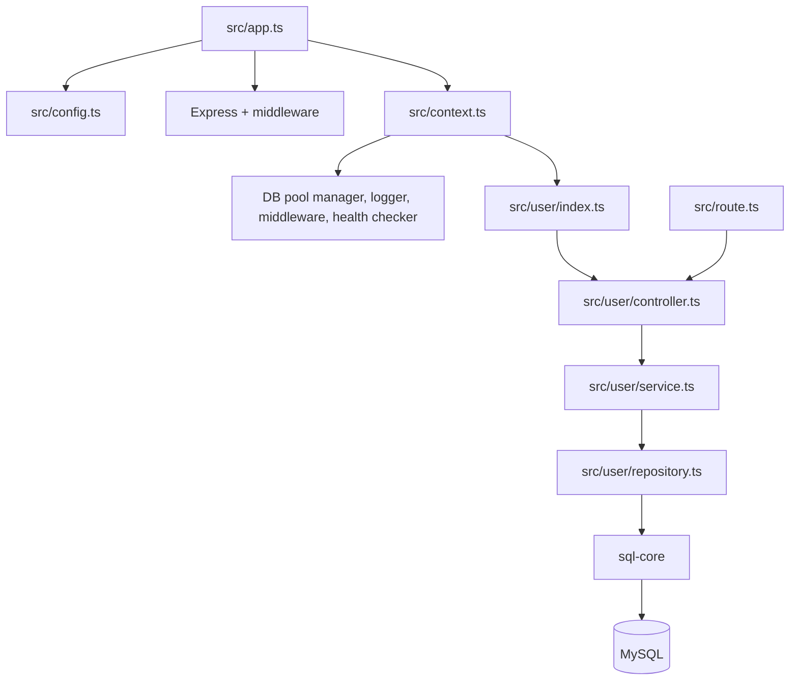
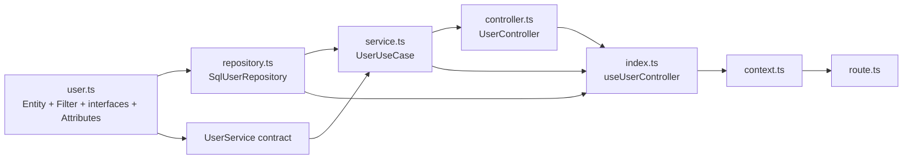

# Architecture and feature implementation guide

## 1. Application composition

The project separates application composition from business-feature implementation.



`src/app.ts` is the composition root. It loads configuration, creates the logger and Express app, installs middleware, creates the MySQL pool, constructs the shared context, registers routes, and starts the HTTP server.

`src/context.ts` constructs shared infrastructure controllers and feature controllers. `src/route.ts` maps HTTP method/path pairs to handlers from that context. The route file does not construct repositories or use cases.

## 2. Current source responsibilities

| File | Responsibility observed in source |
|---|---|
| `src/app.ts` | Loads dotenv, merges config, configures logging and Express middleware, creates the MySQL pool/context, registers routes, starts the server |
| `src/config.ts` | Defines default CORS, logger, middleware, and MySQL settings plus `sit` and `prd` overrides |
| `src/context.ts` | Defines `ApplicationContext`, configures validation resources, constructs health/log/middleware controllers, and creates the user controller |
| `src/route.ts` | Registers system and user HTTP routes |
| `src/user/user.ts` | Defines `User`, `UserFilter`, repository/service interfaces, and `userModel` metadata |
| `src/user/repository.ts` | Binds the generic SQL repository to table `users` and `userModel` |
| `src/user/service.ts` | Adapts the generic `UseCase` base class to the user service contract |
| `src/user/controller.ts` | Parses HTTP input, invokes the user service, validates input, and writes HTTP responses |
| `src/user/index.ts` | Exposes user contracts/controller and builds repository → use case → controller |
| `src/resources/*` | Holds English/Vietnamese strings and language selection |

## 3. The user-module dependency chain



The module is deliberately thin because `Repository` and `UseCase` provide common behavior from dependencies. Do not add a parallel CRUD implementation merely to reproduce behavior already provided by those bases.

### Contracts and metadata — `user.ts`

The file defines:

- `User`: user data shape.
- `UserFilter`: search/filter shape, extending `Filter`.
- `UserRepository`: repository contract extending the shared `Repository` interface.
- `UserService`: service contract extending the shared `Service` interface.
- `userModel`: `Attributes` metadata for keys, lengths, formats, resource labels, and explicit column mapping.

### Persistence — `repository.ts`

`SqlUserRepository` extends `Repository<User, string, UserFilter>` and calls:

```ts
super(db, "users", userModel)
```

Use this pattern when a new feature uses the same generic SQL persistence model. Keep the table and model metadata in agreement.

### Use case — `service.ts`

`UserUseCase` extends `UseCase<User, string, UserFilter>` and passes its `UserRepository` to `super`. It currently contains no additional business rules. Add service methods only when the feature requires behavior beyond the generic use-case operations.

### HTTP adapter — `controller.ts`

`UserController` receives a `UserService`. It binds all six handler methods in the constructor, parses request input, calls the service, and handles status codes/errors. Keep HTTP-specific concerns here; do not put SQL statements in this class.

### Module factory — `index.ts`

`useUserController(db)` constructs `SqlUserRepository`, `UserUseCase`, and `UserController`, then returns the controller. It also re-exports the controller and user contracts/model.

## 4. Workflow for adding a business module

Use this sequence when a feature needs the same CRUD/search structure:

1. **Clarify the contract.** Identify the entity fields, primary key type, SQL table/columns, nullability, validation rules, filter fields, and required endpoints. Resolve schema/model conflicts before coding.
2. **Define contracts and metadata.** Create `src/<feature>/<feature>.ts` with entity/filter interfaces, repository/service interfaces, and an `Attributes` model if the shared SQL/validation approach applies.
3. **Add persistence.** Create `src/<feature>/repository.ts` extending the correct `sql-core` repository base. Pass the shared `DB`, the exact table name, and the feature model to `super`.
4. **Add use-case implementation.** Create `src/<feature>/service.ts` extending `onecore` `UseCase` when the generic operations are sufficient. Add explicit business logic here rather than in the controller.
5. **Add controller.** Create `src/<feature>/controller.ts`; use the existing Express helpers and error/validation pattern. Bind instance methods in the constructor.
6. **Add the feature factory.** Create `src/<feature>/index.ts` and export the intended public symbols. Keep construction in a `use<Feature>Controller(db)` factory.
7. **Wire the application.** Add the controller to `ApplicationContext` and instantiate it in `useContext` in `src/context.ts`.
8. **Register routes.** Add routes to `src/route.ts`. Put static subpaths before parameterized paths when they share a route prefix.
9. **Add resources.** Add English and Vietnamese field labels/messages when model metadata uses resource keys.
10. **Verify and document.** Run available build/type checks, add tests if a test runner is configured, and update README/API/data-model documentation.

A feature that does not need persistence or generic CRUD should not be forced into every step. Follow the responsibility boundaries, not a mechanical file-count rule.

## 5. Runtime dependency composition

`useContext(pool, logger, midLogger)` currently:

- Wraps the MySQL pool in `PoolManager` from `mysql2-core` (used as the `DB` abstraction).
- Creates `LogController` with `updateLogger`.
- Creates `MiddlewareController` with the configured middleware logger.
- Creates `MySQLChecker` from `pool.promise()` and passes it to `HealthController`.
- Creates the user controller using the `DB` abstraction.
- Returns the `ApplicationContext` object.

The validation integration is assigned at module setup in `context.ts`:

```ts
resources.createValidator = createValidator
resources.check = check
```

These are dependency-provided extension points; check their dependency contracts before changing them.

## 6. Boundaries and non-goals

Observed in this source snapshot:

- There is one business feature module (`user`).
- There is no dedicated domain-event, message-queue, cache, authentication, or authorization module in this project.
- There is no migration/schema directory or checked-in SQL setup script.
- There is no test suite.

Do not infer that the application already provides capabilities not represented in its source or dependencies' explicitly verified contracts. Add a new capability only when requested, and document the new dependency and wiring.
